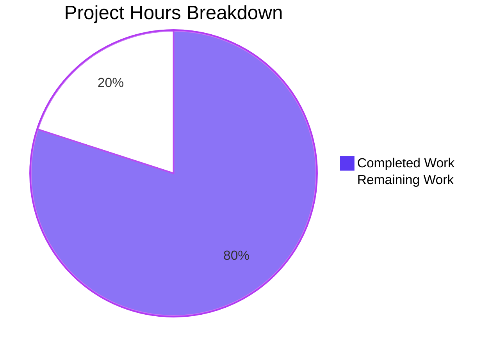
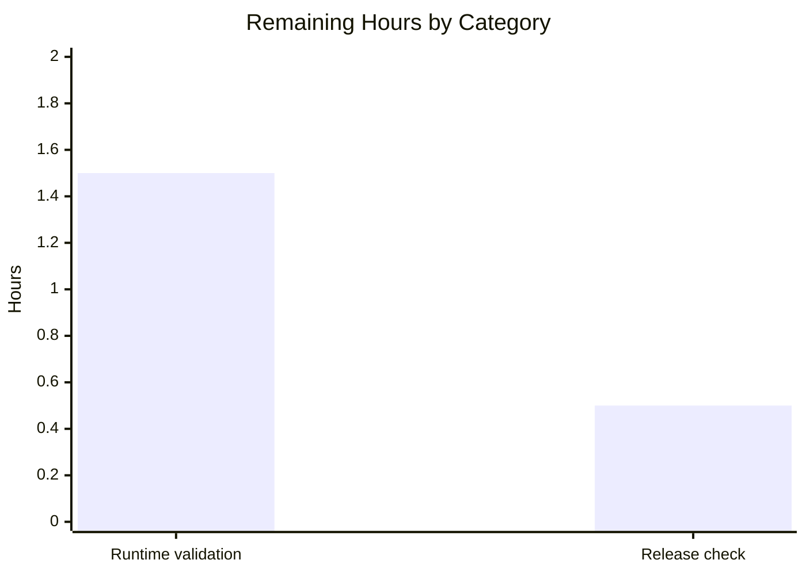

# 1. Executive Summary

## 1.1 Project Overview

A zero-dependency command-line program. One source file, `index.js`, prints the exact line `Welcome to Blitzy` to standard output; one documentation file, `README.md`, records the prerequisite and the single command that runs it. It targets a developer who obtains the repository and runs `node index.js` from its root, with no build, install, configuration, dependency, service or network involvement — the whole interface is one line on the standard output stream. Delivered behaviour is byte-exact and reproducible: 18 bytes ending in one newline, exit status 0, empty standard error, verified on Node.js v22.23.3.

## 1.2 Completion Status



Completed Work — Dark Blue `#5B39F3` · Remaining Work — White `#FFFFFF` · **80% complete**

| Metric | Hours |
|---|---|
| Total Hours | 10.0 |
| Completed Hours (AI + Manual) | 8.0 (8.0 AI / 0.0 human) |
| Remaining Hours | 2.0 |

Completion = Completed / (Completed + Remaining) × 100 = **8.0 / (8.0 + 2.0) × 100 = 80%**, measured against scoped work and path-to-production work only. Every scoped deliverable is complete and verified; the remaining 2.0 hours are release validation (Section 2.2).

## 1.3 Key Accomplishments

- [x] The welcome line — exactly `Welcome to Blitzy`, one unformatted line, exit 0, empty standard error (`index.js`).
- [x] Agreed contents delivered byte-for-byte: `index.js` 2 lines / 66 bytes, `README.md` 3 lines / 95 bytes.
- [x] One command runs it: `node index.js` from the repository root, with nothing to install or build.
- [x] Plain CommonJS loading with no module declaration: `node --check` exits 0 and `require()` loads it.
- [x] Robust invocation: 10 argument variants, 4 standard-input forms and 6 environment variants behave identically.
- [x] Stable and repeatable: 20 sequential and 40 concurrent runs produce one identical line each.
- [x] Install and run record: `README.md` states the only prerequisite and the command that works.
- [x] Exactly two files — no dependency, manifest, test artefact, configuration or CI workflow.

## 1.4 Critical Unresolved Issues

Open items: **0 of the 2 scoped deliverables**; five accepted behaviours follow, none blocking release.

| Issue | Impact | Owner | ETA |
|---|---|---|---|
| Failed standard-output writes are silent: a closed or full stdout still exits 0 | A caller cannot tell from the exit status that the line was discarded | Product owner | No action — accepted by scope |
| No Node.js version floor is declared anywhere in the repository | Consumers cannot check a minimum; verification is on v22.23.3 | Release owner | Before release (task M1, Section 2.2) |
| No automated regression guard exists; the specification excludes a test suite | A future edit to either file is caught only by the manual byte-exact gate | Product owner | No action — gate in place |
| The run command does not state the working directory | The relative invocation fails from any other directory | Product owner | No action — documented in Section 9 |
| No direct-execution path (mode 644, no shebang) | `./index.js` exits 126 `Permission denied` | Product owner | No action — invoke through `node` |

## 1.5 Access Issues

No access issues identified: no credentials, service accounts or network access are needed, and reading the checkout is the only permission required.

## 1.6 Recommended Next Steps

1. **[High]** Validate the documented command on the target Node.js runtime and record the version (task M1, 1.5 h).
2. **[High]** Keep the byte-exact gate as the release check on the release commit (task M2, 0.5 h).
3. **[Medium]** Treat the two files' bytes as the frozen acceptance contract.
4. **[Medium]** State the repository-root requirement of the run command in the release notes.
5. **[Low]** Record the verified behaviour in the release notes for handover.

# 2. Project Hours Breakdown

## 2.1 Completed Work Detail

| Component | Hours | Description |
|---|---|---|
| `index.js` — the welcome-line program | 2.0 | The product in full: one JSDoc summary line above a single `console.log` printing the literal, written to the agreed bytes and executed as a plain CommonJS script with no module declaration (`index.js:1-2`). |
| `README.md` — install and run record | 1.0 | The documentation deliverable: title, the only prerequisite and the single command that runs the product, in three lines (`README.md:1-3`). |
| Runtime verification of the printed line and invocation | 3.0 | The 46 runtime case executions covering exact output bytes, repeat and concurrent runs, argument, standard-input, environment and working-directory variants, module loading and output-failure paths. |
| Specification identity, absence and security verification | 2.0 | The 9 static gates: byte comparison of both files with the agreed contents, structural element counts, forbidden-artefact sweeps over the tree and every parent directory, and the security baseline. |
| **Total** | **8.0** | |

## 2.2 Remaining Work Detail

| Category | Hours | Priority |
|---|---|---|
| **M1** — Node.js runtime validation and version record: validate the documented command on the target interpreter and record the version the release is validated against (path to production) | 1.5 | Medium |
| **M2** — Release-acceptance smoke check: run the byte-exact gate on the release commit and keep it as the release check in place of the test suite the specification excludes (path to production) | 0.5 | Low |
| **Total** | **2.0** | |

## 2.3 Hours Reconciliation

| Sum | Hours |
|---|---|
| Completed (Section 2.1 total) | 8.0 |
| Remaining (Section 2.2 total) | 2.0 |
| Total project hours (Section 1.2) | 10.0 |

Completion = Completed / (Completed + Remaining) × 100 = 8.0 / (8.0 + 2.0) × 100 = **80%**.

No scoped requirement contributes remaining hours: all 26 recorded requirements are complete and verified, so the 2.0 hours are path-to-production validation only. The same three values — 8.0 completed, 2.0 remaining, 10.0 total — appear in the Section 1.2 metrics table and in the Section 7 pie chart.

# 3. Test Results

All 55 case executions passed; none failed. Every row below was executed against the delivered bytes on Node.js v22.23.3.

| Area / Category | Framework | Tests | Passed | Failed | Coverage | What This Proves |
|---|---|---|---|---|---|---|
| Printed-line output and formatting | Node.js v22.23.3 runtime harness (shell) | 8 | 8 | 0 | Not instrumented — no coverage tooling is present or permitted | The program writes exactly `Welcome to Blitzy` followed by one newline and nothing else, with no ANSI bytes even when colour is forced. |
| Repeat-run and concurrent stability | Node.js v22.23.3 runtime harness (shell) | 8 | 8 | 0 | Not instrumented | Output is identical across 20 sequential and 40 concurrent invocations and leaves the working tree byte-identical. |
| Argument handling | Node.js v22.23.3 runtime harness (shell) | 10 | 10 | 0 | Not instrumented | No argument changes anything: line, exit status and stderr are the same for every variant, including shell-injection payloads and non-ASCII input. |
| Standard-input handling | Node.js v22.23.3 runtime harness (shell) | 4 | 4 | 0 | Not instrumented | Input is neither read nor echoed, whether absent, piped, redirected from a file or closed. |
| Environment independence | Node.js v22.23.3 runtime harness (shell) | 6 | 6 | 0 | Not instrumented | Output is independent of the environment, locale, colour settings and a missing home directory. |
| Invocation and module resolution | Node.js v22.23.3 runtime harness (shell) | 3 | 3 | 0 | Not instrumented | The documented repository-root invocation works, and the file loads as a plain CommonJS script from any working directory when given by absolute path. |
| Output-failure paths | Node.js v22.23.3 runtime harness (shell) | 4 | 4 | 0 | Not instrumented | A closed, full or early-closed standard output still leaves the process exiting 0 with empty stderr. |
| Syntax gate, contents identity and absence surface | Node.js v22.23.3 runtime harness (shell) | 12 | 12 | 0 | Not instrumented | Both files are byte-identical to the agreed contents, the syntax gate exits 0, and no dependency, manifest, test or configuration artefact exists in the tree or any parent directory. |

## Not Covered

- **No automated test suite or regression test exists in the repository, and none may be added.** A future edit to `index.js` or `README.md` would be caught only by running the manual gate `node index.js | od -c` (18 bytes, exit 0) plus `sha256sum` on both files. A human should run that gate on every change to the two files.
- **No coverage instrumentation exists or is permitted**, so no coverage percentage is reported for any row above.
- **Runtime behaviour is verified on Linux with Node.js v22.23.3 only.** Other interpreter versions and other operating systems are unverified; the gate should be re-run on the target runtime before release, and note that a terminal-based capture reads 19 wire bytes (`\r\n`) because of the line discipline, so the gate must use a pipe or file sink.
- **The product has no browser, HTTP, API, database or user-interface surface** — no listening socket, server, route, page or persistence code — so no such flow exists to test.
- **Process-level faults were not exercised** beyond the pipe-close case: signals delivered mid-run, memory exhaustion and interpreter crashes are outside what was tested.

# 4. Runtime Validation & UI Verification

Runtime validation drove the product directly as a process on Node.js v22.23.3, from the repository root and by absolute path from other directories.

- ✅ **Start-up and exit** — `node index.js` from the repository root prints the line and exits 0 with empty standard error.
- ✅ **Printed output** — exactly `Welcome to Blitzy`, one unformatted line, 18 bytes with a single trailing newline; no ANSI bytes even under `FORCE_COLOR=3` and `TERM=xterm-256color`.
- ✅ **Repeat and concurrent runs** — 20 sequential and 40 concurrent invocations produce one identical line each and leave the working tree byte-identical.
- ✅ **Arguments** — 10 variants (`--help`, `-h`, `--version`, bare words, empty string, `--`, `--inspect=0`, `; ls /etc/passwd`, `$(whoami)`, non-ASCII text) all yield the same line, exit 0 and empty stderr.
- ✅ **Standard input** — absent, piped text, redirected from a file and closed: input is never read or echoed.
- ✅ **Environment** — empty environment, minimal `PATH`, missing `HOME`, `LC_ALL=C` and `NO_COLOR=1` all produce identical output.
- ✅ **Working directory** — invoked by absolute path from another directory the line is identical; the relative form is fixed at the repository root, where it works.
- ✅ **Module loading and syntax** — `node --check index.js` exits 0, `typeof require` is `function`, and `require('./index.js')` loads and runs the file.
- ⚠ **Output-failure handling** — with stdout closed, sent to `/dev/full` (ENOSPC) or read by an immediately-closing reader, the process still exits 0 with empty stderr, so a caller cannot distinguish a written line from a discarded one; this is accepted by the project's scope, which excludes defensive error handling.

Never exercised at runtime: any user interface, HTTP, API, database or browser flow — the product has no screen, page, route, server, listening socket or external service, so nothing of that kind exists to drive; any interpreter other than Node.js v22.23.3; any operating system other than Linux; and direct `./index.js` execution as an intended path, which exits 126 by design and is not the documented invocation.

# 5. Compliance & Quality Review

## 5.1 Compliance Matrix

| Deliverable / Benchmark | Status | Progress | Evidence |
|---|---|---|---|
| Printed-line behaviour — the exact string, unformatted, one line per run from one output call | ✅ Pass | 100% | `index.js:2`; 8 output cases byte-identical to `Welcome to Blitzy\n`, 0 ANSI bytes |
| Source minimality — one statement plus the single JSDoc line, no variable, function, wrapper, export or shebang, string appearing once | ✅ Pass | 100% | `index.js:1-2`, 2 lines / 66 bytes; every such token count 0 |
| Agreed contents identity — both files delivered to the agreed bytes | ✅ Pass | 100% | `sha256` `33b2990c…f913dc0` and `6d50466c…d19a29c`; contents read back |
| Documentation accuracy — prerequisite and run command true, README under five lines | ✅ Pass | 100% | `README.md:1-3`, 3 lines; the documented command runs the product |
| One-command operation — no build, install, manifest, lockfile or dependency | ✅ Pass | 100% | bare `node index.js`; absence sweep clean in the tree and every parent |
| Module-format simplicity — plain CommonJS, no module declaration | ✅ Pass | 100% | `node --check index.js` exit 0; `require('./index.js')` loads and prints |
| Invocation robustness — arguments, standard input, environment, working directory | ✅ Pass | 100% | 23 case executions, all producing the identical line |
| Output-failure behaviour — closed, full or early-closed stdout leaves exit 0 and empty stderr | ✅ Pass (accepted) | 100% | 4 case executions; defensive error handling is outside the scope |
| No unrequested hardening or extra output — no handler, logging, configuration, banner, usage text or second line | ✅ Pass | 100% | one unconditional statement; 10 argument variants leave output unchanged |
| Scope discipline — no other file, test artefact, configuration, CI workflow or container | ✅ Pass | 100% | tracked tree = `README.md` + `index.js`; 25-name sweep found nothing |
| Smallest-diff compliance — only the planned paths touched, nothing reformatted or renamed | ✅ Pass, with divergence D1 | ~100% | diff vs base = `A index.js` (2/0) and `M README.md` (3/2) |
| Security baseline — no secret, input surface, sink, dependency or network access | ✅ Pass | 100% | credential, input, injection and supply-chain checks all vacuous |

## 5.2 AAP & Rule Divergences and Gaps

| # | What the AAP/Rule Required | What Was Delivered Instead | Why It Diverged | Impact | Remediation |
|---|---|---|---|---|---|
| D1 | "The change is purely additive, so no existing line, file name or formatting is disturbed", with the repository described as holding zero entries and both files as new creations | `index.js` created from nothing (`3e1b607`, `A index.js`, +2/0) and `README.md` replaced in place over a pre-existing two-line scaffold (`8683870`, `M README.md`, +3/−2) | The base commit `7671405` already tracked a two-line `README.md` (`# test---new-product---build3-df26ee6f` / `Created by Blitzy`), and the agreed README contents had to occupy its place | The change is not purely additive for `README.md` and the scaffold's original title text is gone; behaviour, acceptance and the small diff are unaffected | None — restoring the scaffold would breach the agreed README contents |
| D2 | "Fewest lines: one statement plus the single JSDoc line, and nothing else", against the request's "as less lines as possible by optimizing token usage" | `index.js:1` carries the single comment line `/** Prints the welcome line. */`, so the file is two lines rather than one | The request's own constraint block presumes a one-line JSDoc summary and the agreed contents fix it as the file's only comment; the two directives conflict and the doc-comment directive was given effect | One comment line (31 characters) beyond a strict minimum; no effect on behaviour, performance or security | None unless the bare statement is preferred — that is a re-agreement of the file's contents. **Sanctioned** |

**D1 — the in-place README replacement.** The base commit `7671405` tracked a two-line `README.md` (`# test---new-product---build3-df26ee6f` / `Created by Blitzy`), so the deliverable could not be added beside it: the file's text was replaced in place to reach the agreed three lines, while `index.js` was added from nothing. Nothing else in the tree was touched, reformatted, renamed or restructured — `git diff --name-status 7671405 HEAD` lists only those two paths. The consequence is that the diff is not purely additive for `README.md` and the scaffold's original title text no longer exists. No action is required: restoring the scaffold would breach the agreed README contents, and a reader who wants the additive-only shape must re-agree those contents with whoever commissioned the documentation.

**D2 — the retained JSDoc line.** The request asks for the fewest lines possible while its own constraint block presumes a one-line JSDoc summary, and the two pull in opposite directions: the comment takes `index.js` to two lines where the single statement alone would fit in one. The comment was written because the agreed contents fix it as the file's only comment and describe it as the shortest summary of the behaviour, and it is accurate — the statement beneath prints exactly the line the comment names. The cost is one line of 31 characters; behaviour, performance and security are unaffected. Closing it means deleting the comment and re-agreeing the file's contents, which is why this divergence is marked sanctioned rather than open.

No divergence from user-supplied rules was identified: no user rules accompany this work, so the request's constraint block is the entire rule set, and beyond the line-count tension recorded above every directive in it is realised in full. The out-of-scope prohibitions hold — the tree contains exactly the two planned files and nothing the request forbids.

# 6. Risk Assessment

| Risk | Category | Severity | Probability | Mitigation | Status |
|---|---|---|---|---|---|
| Failed standard-output writes are silent: a closed, full or early-closed stdout still exits 0 with empty stderr | Operational | Medium | Low | Verify delivery at the consumer end, and treat the gate's byte comparison as the acceptance signal rather than the exit status alone | Accepted by scope — the project excludes defensive error handling |
| No automated regression guard: an edit to either file is caught only by a manual check | Technical | Medium | Medium | Keep the byte-exact gate (18 bytes, exit 0) plus `sha256sum` of both files as the merge gate | Open — a test suite is excluded by the specification, so the gate is the guard |
| The acceptance criterion is frozen at the two files' bytes, so any addition (a statement, a shebang, a fourth README line) breaches it | Technical / Maintainability | Medium | High | Treat the bytes as the contract and re-agree the criterion before extending the product | By design — requires an explicit decision whenever the product grows |
| No Node.js version floor is declared: no manifest, engines field or version file records the interpreter the output was verified on | Operational | Low | Medium | Record the validated interpreter version in the release notes and re-run the gate on the target runtime | Open — task M1 |
| The documented command is relative, so it fails with `MODULE_NOT_FOUND` from any other working directory | Operational | Low | Medium | Run it from the repository root or pass the absolute path; state the requirement in the release notes | Accepted and documented in Section 9 |
| No direct-execution path: the file is mode 644 with no shebang, so `./index.js` exits 126 | Operational | Low | Low | Invoke the file through `node` as documented | Accepted by scope |
| All verification was performed on Linux with Node.js v22.23.3 | Technical | Low | Low | Re-run the byte-exact gate on the target platform and runtime before release | Open — task M1 |

Security risk is limited to the interpreter and platform themselves: the product reads no input, opens no socket, writes no file and imports nothing, so it presents no secret to leak, no input to validate and no sink to reach. Integration risk is absent for the same reason — the program's only interface is the standard output stream, and it depends on no external service, data format or credential that could change beneath it.

# 7. Visual Project Status


Completed Work — Dark Blue `#5B39F3` · Remaining Work — White `#FFFFFF` · **80% complete** (8.0 of 10.0 hours): the same values as Section 1.2 and Sections 2.1–2.2.



Priority distribution of the remaining 2.0 hours: 1.5 hours Medium (validate the documented command on the target Node.js runtime and record the version) and 0.5 hours Low (release-acceptance smoke check of the byte-exact gate on the release commit). No remaining work carries High priority, because nothing blocks the product: it runs, prints the exact line and exits 0 on its only code path.

# 8. Summary & Recommendations

**What was delivered.** The project ships a complete, zero-dependency command-line program: `index.js` prints the exact line `Welcome to Blitzy` as one unformatted standard-output line and exits 0 with empty standard error, and `README.md` records the only prerequisite and the single command that runs it. Nothing else exists in the tree — no manifest, lockfile, dependency, configuration, test artefact or CI workflow — and nothing was asked for. The two files are delivered byte-for-byte to the agreed contents: `index.js` at 2 lines and 66 bytes, `README.md` at 3 lines and 95 bytes.

**What was verified.** The product was exercised as a running process rather than only read: 55 case executions, all passing, covering the exact output bytes and the absence of any formatting, repeat and concurrent invocations, ten argument variants including injection payloads, four standard-input forms, six environment and locale variants, invocation from other working directories, the module-loading and syntax gates, four output-failure paths, and the byte-level identity and absence surface of the tree. The documented command was extracted from `README.md` and run, and it prints the line it promises. Security review is clean by construction rather than by exception handling: no secret, no input surface, no reachable sink, no import.

**Completion and the critical path.** Against its own scope the project is 80% complete: 8.0 hours of completed work out of 10.0 total. Every scoped deliverable is finished and verified — no requirement is part-written and none is unstarted — so the 2.0 remaining hours are release validation rather than product work: 1.5 hours to validate the documented command on the target Node.js runtime and record the validated version, since no version floor is declared anywhere, and 0.5 hours to run the byte-exact gate on the release commit and keep it as the release check in place of the test suite the specification excludes. Those two tasks are the critical path to production, and neither depends on the other.

**Readiness assessment.** For the use it was built for, the project is ready to ship: an operator with only Node.js installed obtains the repository, runs `node index.js` from the repository root and sees exactly `Welcome to Blitzy`, with nothing to install, build, transpile, configure or authenticate, no port to open and no service to start. The residual exposure is operational and small: standard-output write failures are silent by design, so a caller should not rely on the exit status alone to know the line arrived; the run command is relative, so it belongs at the repository root or must be given an absolute path; and the acceptance criterion is frozen at the two files' bytes, so any addition to them — a statement, a shebang, a fourth README line — breaches it and requires the criterion to be re-agreed first.

**Recommendations.** Validate the command on the target interpreter and record that version (task M1), then run the gate on the release commit and treat its result as the acceptance record (task M2). Keep `sha256sum` of both files alongside the gate so an accidental edit is caught as a byte change rather than being read as a behaviour change. Accept the two recorded divergences — the in-place `README.md` replacement and the retained JSDoc line — as delivered, since closing either would breach the agreed contents; revisit them only if the reader wants the file extended, in which case the contents should be re-agreed deliberately.

# 9. Development Guide

Every command below was run from the repository root on Linux with `/usr/bin/node` v22.23.3, and the output shown is the output observed.

## 9.1 System Prerequisites

- **Node.js** — any CommonJS-capable release. Verified on `v22.23.3`.
- Nothing else: no package manager step, no compiler, no database, no service, no port, no credentials and no environment variable.

```bash
node --version          # v22.23.3 (verified interpreter)
```

## 9.2 Environment Setup

There is no setup step. Obtain the repository and change into its root — the two files `index.js` and `README.md` are the whole environment.

```bash
cd /path/to/repository
ls -la                  # index.js (66 B), README.md (95 B)
```

Do **not** run `npm install`: there is no manifest, no lockfile and no dependency, and adding one would breach the project's agreed contents.

## 9.3 Dependency Installation

None. Nothing is installed, and the program imports nothing:

```bash
grep -cE 'require|import ' index.js    # 0
```

## 9.4 Application Startup

The product has no server and no daemon; it is a single command that prints one line and exits.

```bash
node index.js
# Welcome to Blitzy
echo "exit=$?"          # exit=0
```

## 9.5 Verification Steps

Byte-exact gate — the release check, and the only regression guard this project has:

```bash
node index.js | od -c
# 0000000   W   e   l   c   o   m   e       t   o       B   l   i   t   z
# 0000020   y  \n
# 0000022

node index.js | wc -c   # 18
node index.js | wc -l   # 1
```

Repeat-run and separation checks:

```bash
node index.js > run1.txt && node index.js > run2.txt && cmp run1.txt run2.txt && echo identical
node index.js > out.txt 2> err.txt; echo "exit=$?"; wc -c out.txt err.txt   # exit=0, 18 out.txt, 0 err.txt
```

Syntax and module-format gates:

```bash
node --check index.js                                    # exit 0
node -e "console.log(typeof require)"                    # function
node -e "console.log(require.resolve('./index.js'))"     # /path/to/repository/index.js
```

Contents integrity — the acceptance contract:

```bash
sha256sum index.js README.md
# 33b2990ccdc3bd3b2684227d7b6995fe8f8b023d4b3a96da5602d97c9f913dc0  index.js
# 6d50466cd632f53c62c26b70f3a33b1a5f169971d02e7aecf13db9fe5d19a29c  README.md
wc -c index.js README.md; wc -l index.js README.md       # 66 / 95 bytes, 2 / 3 lines
```

## 9.6 Example Usage

Capture the line, then confirm it arrived where expected:

```bash
node index.js > welcome.txt 2> welcome.err
echo "exit=$?"                       # exit=0
cat welcome.txt                      # Welcome to Blitzy
wc -c welcome.err                    # 0 welcome.err
```

Run it from another directory by absolute path — useful in scripts and from scheduled jobs:

```bash
(cd "$HOME" && node /path/to/repository/index.js)
# Welcome to Blitzy
```

The program ignores arguments, standard input and the environment, so wrapping it adds nothing:

```bash
node index.js --help                 # Welcome to Blitzy   (exit 0, no usage text)
printf 'ignored\n' | node index.js   # Welcome to Blitzy   (input never read)
env -i /usr/bin/node index.js        # Welcome to Blitzy   (no environment needed)
```

## 9.7 Troubleshooting

| Symptom | Cause | Resolution |
|---|---|---|
| `Error: Cannot find module '/some/dir/index.js'` (`MODULE_NOT_FOUND`, exit 1) | The relative command was run from a directory other than the repository root | Run `node index.js` from the repository root, or pass the absolute path: `node /path/to/repository/index.js` |
| `Permission denied` (exit 126) | `./index.js` was executed directly; the file is mode 644 with no shebang | Invoke it through the interpreter: `node index.js` |
| No output, exit 0 when piping into a reader that exits early | The reader closed the pipe; failed standard-output writes are silent by design | Read the output into a file first (`node index.js > out.txt`) and check the file's 18 bytes |
| Output looks 19 bytes on a terminal | The terminal's line discipline appends a carriage return (`\r\n`) | Measure through a pipe or file sink: piping the run into `wc -c` reports 18 bytes |
| Something in the tree changed unexpectedly | No tooling guards the two files | Re-run the gate and the `sha256sum` comparison above; the bytes are the contract |

# 10. Appendices

## A. Command Reference

| Purpose | Command (from the repository root) |
|---|---|
| Run the product | `node index.js` |
| Release gate, byte-exact | `node index.js \| od -c` → 18 bytes, exit 0 |
| Output size and line count | `node index.js \| wc -c` → 18 · `node index.js \| wc -l` → 1 |
| Syntax gate | `node --check index.js` → exit 0 |
| Module-format check | `node -e "console.log(typeof require)"` → `function` |
| Contents identity | `sha256sum index.js README.md` |
| Size and line counts | `wc -c index.js README.md` · `wc -l index.js README.md` |
| Tree inventory | `git ls-files` → `README.md`, `index.js` |
| Change shape | `git diff --name-status 7671405 HEAD` → `M README.md`, `A index.js` |
| Run from another directory | `node /absolute/path/to/index.js` |

## B. Port Reference

None. The product opens no port, starts no listener and makes no outbound connection: it writes one line to the standard output stream of the process that invoked it. A listening-socket check on the running process finds nothing (0 IPv4, 0 IPv6). No port, firewall rule, service definition or host binding applies.

## C. Key File Locations

| Path | Role |
|---|---|
| `index.js` | The entire product: one JSDoc summary line above a single `console.log` that prints `Welcome to Blitzy`. Entry point and the file the run command names. |
| `README.md` | The install and run record: title, prerequisite and the single command. |

Both live at the repository root, and they are the only tracked files — no directory, subtree, test tree, documentation folder, configuration file or workflow exists beside them.

## D. Technology Versions

| Technology | Version / Detail |
|---|---|
| Node.js | v22.23.3 verified (the only prerequisite) |
| JavaScript | CommonJS script, no module-format declaration, no transpilation |
| Runtime dependencies | None |
| Build tooling | None |
| Package manifest / lockfile | None |

## E. Environment Variable Reference

No environment variable is read, required or set by the product: an invocation under an empty environment (`env -i /usr/bin/node index.js`) prints the same line with exit 0. Nothing needs to be exported before running it, and the program behaviour is identical under an empty environment, a minimal `PATH`, a missing `HOME`, `LC_ALL=C` or `NO_COLOR=1`.

## F. Developer Tools Guide

| Tool | Purpose here |
|---|---|
| `node` | Runs the product, the syntax gate (`node --check`) and the module-loading check (`node -e`). |
| `od -c` | Renders the 18 output bytes so the exact line and its single newline can be inspected. |
| `wc -c` / `wc -l` | Confirm 18 bytes and one line per run. |
| `cmp` | Compares two captured runs, or a capture against an expected line, byte for byte. |
| `sha256sum` | Records the contents identity of both files — the acceptance contract. |
| `git` | Shows the change shape and confirms nothing outside the two planned paths was touched. |

No linter, formatter, coverage tool or test runner exists in this project and none may be added: the specification excludes a test suite, and the byte-exact gate above is the regression guard. Run it, together with `sha256sum`, on every change to the two files.

## G. Glossary

| Term | Meaning |
|---|---|
| Agreed contents | The fixed bytes of `index.js` (2 lines, 66 bytes) and `README.md` (3 lines, 95 bytes); the project's acceptance criterion. |
| Byte-exact gate | `node index.js \| od -c`, which must show exactly `W e l c o m e   t o   B l i t z y \n` (18 bytes) with exit 0. |
| CommonJS | Node.js's default module format for a `.js` file with no manifest above it; no declaration is needed here. |
| Exit status | The process's numeric result: 0 on the only code path. A failed write to stdout does not change it. |
| JSDoc summary | The single `/** ... */` comment line above the statement, describing the behaviour the bare call does not name. |
| Standard error | The diagnostic stream; the program writes 0 bytes to it on every run. |
| Standard output | The program's only interface: one line, 18 bytes, one trailing newline. |
| Unformatted output | No colour, label, log level, prefix, timestamp or indentation surrounds the printed line. |
